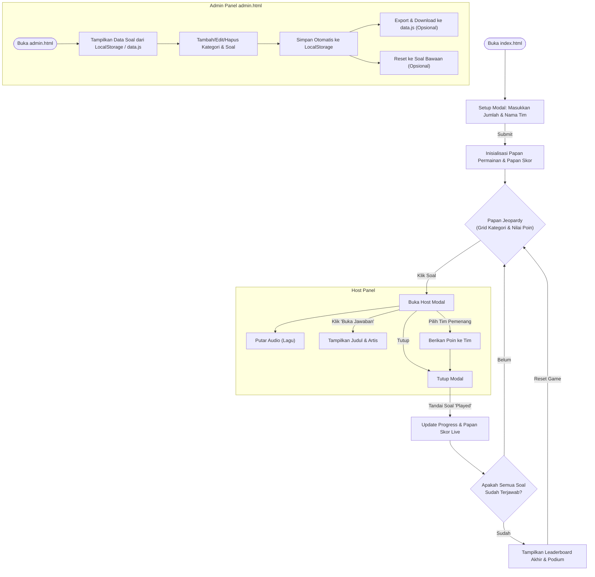

# Cara Kerja Aplikasi Summer Love Music Quiz

## 1. Ringkasan Aplikasi
Aplikasi ini adalah permainan kuis tebak lagu berbasis web yang terinspirasi dari format acara TV "Jeopardy!". Permainan ini dirancang untuk dipandu oleh seorang "Host" atau pembawa acara yang mengontrol jalannya permainan, memilih soal dari papan kategori, memutar cuplikan lagu (audio), dan memberikan poin kepada tim yang berhasil menebak dengan benar. 

Selain mode permainan, aplikasi ini juga memiliki panel Admin (`admin.html`) yang digunakan untuk manajemen data (membuat, mengubah, dan menghapus kategori maupun soal) tanpa harus mengedit kode secara manual.

---

## 2. Alur Kerja Permainan (Flowchart)

Berikut adalah visualisasi alur kerja dari aplikasi ini, mulai dari Setup awal hingga Leaderboard akhir, serta alur pada panel Admin:

---

## 3. Komponen Utama Aplikasi

Aplikasi ini dibagi menjadi beberapa file utama yang bekerja saling beriringan:
- **`index.html` & `script.js`**: Merupakan halaman utama dan logika untuk menjalankan permainan (Game UI & Game Logic).
- **`admin.html` & `admin.js`**: Merupakan halaman dasbor admin dan logikanya untuk memodifikasi soal (CRUD).
- **`data.js`**: Bertindak sebagai "database" awal (fallback) yang memuat kumpulan kategori, pertanyaan, informasi path audio, dan jawaban.
- **`style.css`**: Menyimpan semua styling (CSS) untuk membuat tampilan antarmuka yang menarik, pewarnaan, dan tata letak.

---

## 4. Penjelasan Detail Fungsi-Fungsi (Functions)

### A. Sisi Permainan (`script.js`)
File ini menangani seluruh interaksi saat game dimainkan. Data pertanyaan diambil dari `localStorage` (jika pernah diedit via Admin), atau akan menggunakan variabel `GAME_DATA` bawaan.

* **Fungsi Inisialisasi & Setup:**
  * `initSetupModal()` & `renderTeamInputs()`: Menampilkan form di awal permainan untuk menentukan berapa banyak tim yang bermain dan meminta input nama untuk masing-masing tim tersebut.
  * `handleSetupSubmit(e)`: Mengambil data nama tim dari form, membuat objek tim dengan skor awal `0` ke dalam array `teams`, lalu menyembunyikan modal setup untuk memulai permainan.
  * `initGame()`: Fungsi utama yang dipanggil setelah setup selesai untuk merender papan skor (`renderScoreboard`) dan papan pertanyaan (`renderBoard`).

* **Fungsi Papan Permainan:**
  * `renderScoreboard()`: Menampilkan papan skor di sebelah kiri layar. Papan ini akan selalu mengurutkan tim dari skor tertinggi ke terendah (Live Leaderboard).
  * `renderBoard()`: Membangun grid "Jeopardy" secara dinamis berdasarkan jumlah kategori dan soal yang ada. Setiap sel kartu memiliki *event listener* yang jika diklik akan membuka modal soal tersebut.

* **Fungsi Kontrol Host (Host Modal):**
  * `openHostModal(question, categoryName, cellElement)`: Dipanggil ketika sel poin diklik. Fungsi ini menghentikan aksi jika soal sudah pernah dijawab (`played`). Fungsi ini menyiapkan judul, menyiapkan audio player (`<audio>`), dan merender tombol-tombol tim untuk pemberian poin.
  * `handleReveal()`: Dijalankan saat host mengklik "Buka Jawaban". Menampilkan judul lagu dan nama artis kepada pemain.
  * `awardPoints(teamId, points)`: Menambahkan nilai poin soal ke skor total tim yang dipilih, lalu memperbarui UI skor dengan efek animasi (menggunakan GSAP).
  * `closeHostModal(markPlayed)`: Menutup modal host, mem-pause audio yang sedang berjalan, dan (jika diset `true`) mengubah status sel di papan menjadi redup/hilang poinnya sebagai penanda bahwa soal telah dimainkan.

* **Fungsi Progress & Leaderboard Akhir:**
  * `updateProgressUI()`: Mengubah teks indikator kemajuan (contoh: "Progress: 5 / 25 Soal").
  * `checkGameCompletion()`: Mengecek apakah jumlah soal yang sudah ditandai `played` sama dengan total soal. Jika ya, permainan dianggap selesai dan otomatis memanggil fungsi `openLeaderboardModal()`.
  * `openLeaderboardModal()`: Menampilkan popup podium akhir yang berisi peringkat keseluruhan tim beserta skor finalnya.
  * `resetGameProgress()`: Mengembalikan semua skor tim ke `0` dan menghapus status `played` dari semua soal sehingga permainan dapat diulang tanpa harus merefresh halaman atau mengatur ulang nama tim.

### B. Sisi Admin / Pengaturan (`admin.js`)
File ini mengatur pembuatan, pengeditan, dan penghapusan data soal. Segala perubahan yang dilakukan di sini akan langsung disimpan ke memori penyimpanan lokal browser (`localStorage`).

* **Fungsi Manajemen Tampilan Utama:**
  * `renderAdminBoard()`: Membaca struktur data kategori dan soal yang ada saat ini, lalu mencetaknya ke dalam bentuk daftar tabel (UI) agar mudah dibaca dan dikelola oleh Admin.

* **Fungsi Kategori & Soal (CRUD):**
  * `handleAddCategory(e)`: Menerima input teks untuk membuat blok kategori lagu yang baru.
  * `deleteCategory(catIndex)` & `deleteQuestion(catIndex, qIndex)`: Menghapus kategori keseluruhan atau hanya menghapus soal spesifik beserta konfirmasi peringatannya.
  * `openAddQuestion()` & `openEditQuestion()`: Membuka modal popup untuk menginput atau mengubah rincian soal (Nilai Poin, Judul Lagu, Artis, dan direktori file Audio). Pada fungsi tambah, nilai poin juga akan disarankan secara otomatis (+100 dari poin tertinggi di kategori tersebut).
  * `handleSaveQuestion(e)`: Memvalidasi form soal, menyimpan perubahan ke dalam array `gameData`, dan menutup modal.

* **Fungsi Penyimpanan & Ekspor Data:**
  * `saveToLocal()`: Fungsi penting yang dipanggil setiap kali terjadi perubahan data. Mengubah data JSON ke string dan menyimpannya di `localStorage` dengan key `jeopardyData`.
  * `handleExport()`: Karena browser tidak bisa langsung mengedit file `data.js` milik sistem, fungsi ini mengonversi `gameData` menjadi string berformat JavaScript (`const GAME_DATA = [...]`), lalu memicu browser untuk mendownload (mengunduh) file tersebut dengan nama `data.js`. Pengguna kemudian bisa menimpa file aslinya.
  * `handleReset()`: Menghapus cache/simpanan `jeopardyData` dari localStorage dan me-refresh data agar menggunakan variabel fallback (asli) yang ada pada file `data.js`.
